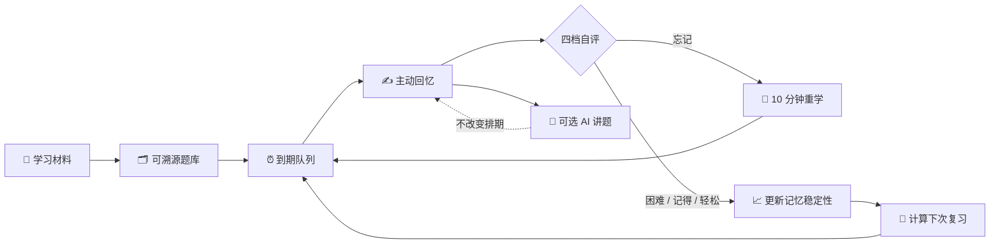

<div align="center">

# 🧠 忙里偷题

### Money to Tip · Small tips, big steps.

**把碎片时间，变成真正记得住的知识。**

任意材料 → 可溯源的题 → 艾宾浩斯科学复习 → 答错就地讲明白

[](https://www.python.org/)
[](https://fastapi.tiangolo.com/)
[](https://react.dev/)
[](https://web.dev/learn/pwa/)
[](https://www.sqlite.org/)

[核心能力](#-核心能力) · [记忆引擎](#-可解释的记忆引擎) · [快速启动](#-快速启动) · [项目架构](#-项目架构) · [路线图](#-路线图)

</div>

---

> [!IMPORTANT]
> **当前状态**：科学记忆引擎、移动端核心体验、账号登录与首次引导、可恢复复习、真实记忆洞察和管理端路由已完成，并通过后端、组件、E2E 与三视口视觉验收。README 只描述当前已经落地的主流程。

## ✨ 为什么是忙里偷题

<table>
<tr>
<td width="25%">

### 🎯 学得快
打开即是一道题。选择题、填空、判断、问答与场景设计统一进入流畅的复习队列。

</td>
<td width="25%">

### 🧠 记得住
每道题独立记忆稳定性，四档评分驱动下一次出现时间；答错进入 10 分钟重学。

</td>
<td width="25%">

### 🔎 讲得透
答案、讲解、出处一体呈现；需要时调用自己的模型讲题，并生成同类变式题。

</td>
<td width="25%">

### 🔐 拿得走
自部署、SQLite、每日备份、完整导入导出。学习数据始终由你掌握。

</td>
</tr>
</table>



## 🚀 核心能力

| 能力 | 已实现体验 |
|---|---|
| **题库管理** | 题库 → `::` 层级分类 → 五种题型；Markdown 内容、标签、难度、来源与状态 |
| **专注刷题** | 到期题优先、新题补足、四档评分预览、会话内重学、训练计划与每日目标 |
| **科学复习** | 指数遗忘近似、目标保持率 `0.85`、分钟级 `due_at`、个性化稳定性、短时重学 |
| **可靠记录** | `client_id` 幂等回写、失败可见、同键重试、按用户隔离的刷新恢复与退出清理 |
| **AI 辅助** | 手动问 AI、三类追问、同类变式题；求助单独记日志，不影响排期 |
| **学习统计** | 今日真实进度、未来负荷、实际保持率与样本量、遗忘恢复和薄弱分类下钻 |
| **Anki 迁移** | `.apkg`（anki21 / anki21b）与 TSV 导入、牌组层级转分类、导入报告 |
| **数据主权** | 每日自动备份、版本化完整导出、旧版导入适配、数据清空 |
| **多用户隔离** | 管理员 / 普通用户、多设备令牌、吊销、按用户隔离题目与学习记录 |
| **一体部署** | 一个 Docker 容器同时提供产品主页、学习 PWA、管理后台和 API |

## 🧮 可解释的记忆引擎

忙里偷题以艾宾浩斯遗忘规律为启发，用透明的指数模型近似记忆随时间的变化：

```text
R(t) = exp(-t / S)

R：经过时间 t 后的预计保持率
S：当前用户对这道题的记忆稳定性（天）
```

默认目标保持率为 **0.85**，下一次复习间隔为：

```text
interval = -S × ln(0.85)
```

每次回答都会更新这道题的个人稳定性，而不是套用所有人的固定日历：

| 评分 | 你的感受 | 对排期的影响 |
|---|---|---|
| `again` | 没有回忆起来 | 降低稳定性，10 分钟后重学，并回到本次会话 |
| `hard` | 回忆困难 | 小幅增加稳定性，间隔不短于当前间隔 |
| `good` | 正常回忆 | 稳定性 × 2.0，按目标保持率重新排期 |
| `easy` | 轻松回忆 | 稳定性 × 2.8，拉长下一次出现时间 |

安全边界为 **10 分钟～365 天**。每次提交保存算法版本与决策快照，因此历史排期可以解释、重放和迁移。

> [!NOTE]
> 这是一种可解释的工程近似，不承诺“保证记住”。记忆洞察明确区分**用于排期的模型预测**与来自真实复习日志的**实际保持率**，少于 20 次有效样本时不显示百分比。

## ⚡ 快速启动

### 方式一：Docker，一条命令跑完整产品

```bash
git clone https://github.com/shiyinhongsama/mtt.git
cd mtt
docker compose up -d --build
```

创建管理员并获取初始凭证：

```bash
docker compose exec moneytotip uv run --no-sync mtt user-create admin --admin
```

| 入口 | 地址 | 当前登录方式 |
|---|---|---|
| 🏠 产品主页 | http://localhost:8000/ | 无需登录 |
| 📱 学习 PWA | http://localhost:8000/app/ | 账号密码；首次可一键创建 3 道示例题 |
| 🛠️ 管理后台 | http://localhost:8000/console/ | 管理员账号密码 |
| ❤️ 健康检查 | http://localhost:8000/health | 无需登录 |

数据持久化在 Docker 卷 `mt-data`；删除容器不会删除学习数据。停止与恢复：

```bash
docker compose down
docker compose up -d
```

### 方式二：本地开发

<details open>
<summary><b>① 启动后端 · 8000</b></summary>

```bash
cd moneyToTip
uv sync --frozen
uv run mtt init-db
uv run mtt user-create admin --admin --password '<local-only-password>'
uv run mtt serve
```

</details>

<details>
<summary><b>② 启动学习 PWA · 5173</b></summary>

```bash
cd moneyToTipApp
npm ci
npm run dev
```

开发服务器将 `/api` 代理到 `127.0.0.1:8000`。

</details>

<details>
<summary><b>③ 启动管理后台 · 5174</b></summary>

```bash
cd moneyToTipConsole
npm ci
npm run dev
```

</details>

构建后的 `dist/` 也可由 FastAPI 自动托管：学习端 `/app/`，管理端 `/console/`。需要自定义路径时使用 `MTT_WEBAPP_DIST` 与 `MTT_CONSOLE_DIST`。

## 🤖 模型配置 · BYOK

AI 讲题使用 OpenAI 兼容接口。没有模型 Key 时，题库、复习、排期、统计和备份仍可正常使用。

在根目录创建 `.env`（Docker Compose 读取）：

```bash
MTT_MODEL_API_KEY=sk-your-local-key
MTT_MODEL_BASE_URL=https://api.minimaxi.com/v1
MTT_MODEL_NAME=MiniMax-M3.1-Flash
```

`.env` 已被 Git 忽略。不要把真实 Key、token、数据库或备份提交到仓库。

## 🏗️ 项目架构

```text
mtt/
├── moneyToTip/              # FastAPI · SQLModel · SQLite · Alembic · Typer
│   ├── mtt/identity/        # 用户、令牌、登录
│   ├── mtt/corpus/          # 题库、分类、题目
│   ├── mtt/schedule/        # 记忆引擎、到期队列、训练计划
│   ├── mtt/growth/          # 学习统计
│   ├── mtt/data/            # 备份、导入、导出
│   └── tests/               # 领域、接口、并发与迁移测试
├── moneyToTipApp/           # React 学习 PWA
├── moneyToTipConsole/       # Ant Design 管理后台
├── docs/superpowers/        # 产品设计与实施计划
└── docker-compose.yml       # All-in-One 部署
```

这是一个**单 Git 仓库的三应用 monorepo**，不是三个嵌套仓库。贡献约定与安全边界见 [AGENTS.md](AGENTS.md)。

## ✅ 测试与验证

```bash
# 后端：领域逻辑、API、并发幂等、每日进度、迁移与数据兼容
cd moneyToTip
uv run --frozen pytest -q

# 学习端：组件、真实浏览器、视觉基线与 PWA 生产构建
cd ../moneyToTipApp
npm ci
npx playwright install chromium
npm test
npm run test:e2e
npm run test:visual
npm run build

# 管理端：路由组件测试与生产构建
cd ../moneyToTipConsole
npm ci
npm test
npm run build
```

E2E 为每个测试启动独立的 FastAPI、Vite 和临时 SQLite，覆盖登录、示例题、弱网重试、刷新恢复、搜索和批量确认部分失败，不连接开发数据库。视觉基线覆盖今日、复习、题库和洞察的 **360 / 768 / 1440px** 视口，并检查横向溢出与评分按钮触控尺寸。

**2026-11-26 发布验收结果**：后端 **83 项**、学习端组件 **40 项**、管理端路由 **3 项**、核心 E2E **3 项**、三视口视觉测试 **3 项**全部通过；学习端与管理端生产构建均成功。

## 🗺️ 路线图

- [x] 题库、训练计划、AI 讲题、统计、管理后台骨架
- [x] 可靠复习提交与并发幂等
- [x] 艾宾浩斯启发式记忆引擎与分钟级评分预览
- [x] Alembic 版本化迁移与新旧导出兼容
- [x] 每日目标按不同题目准确计数
- [x] 可恢复的复习会话状态机与专注复习页
- [x] 移动端设计系统、今日、题库与记忆洞察重设计
- [x] 普通用户账号登录、首次引导与示例题
- [x] 核心 E2E、弱网恢复与多视口视觉回归
- [ ] 核心体验稳定后，再闭合 Markdown / AI 出题内容供应链

详细任务、接口、测试和提交检查点见[体验重设计实施计划](docs/superpowers/plans/2026-11-25-memory-experience-redesign.md)。

## 📚 设计与协作文档

- [科学记忆引擎与核心体验重设计](docs/superpowers/specs/2026-11-25-memory-experience-redesign-design.md)
- [可靠复习与记忆引擎实施计划](docs/superpowers/plans/2026-11-25-reliable-memory-engine.md)
- [核心体验重设计实施计划](docs/superpowers/plans/2026-11-25-memory-experience-redesign.md)
- [仓库协作指南](AGENTS.md)

---

<div align="center">

**少一点遗忘，多一点确定。**

🧠 忙里偷题 · Small tips, big steps.

</div>
